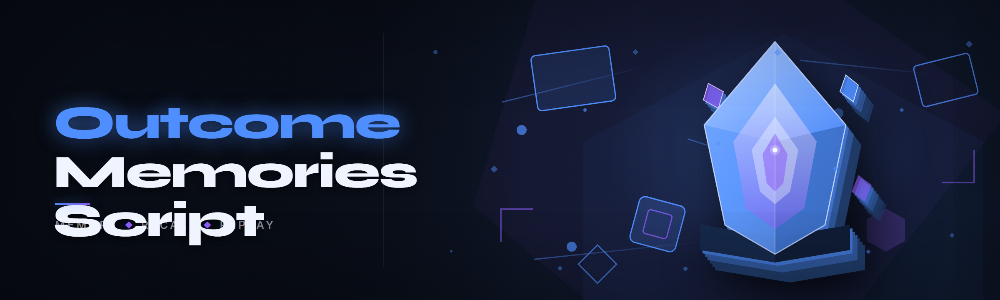

  
  
  

  

  
  
  

---

**Outcome Memories Script 2026** — the free, community-built reimplementation of the Outcome Memories suite, rebuilt from scratch after six months of digging through forum archives, decompiled scripts, and broken paid builds.

---

## 🕹️ Compatibility matrix

Before you touch anything, check whether your setup is in the supported band. This is the first thing people skip on the forum, and it's the first thing that breaks things.

| OS | Build | Game / Platform Version | State |
|---|---|---|---|
| Windows 11 24H2 / 25H2 | 26100+ | Current public branch | ✅ Fully supported |
| Windows 11 23H2 | 22631 | Current public branch | ✅ Fully supported |
| Windows 10 22H2 | 19045 | Current public branch | ✅ Fully supported |
| Windows 10 21H2 | 19044 | Current public branch | ⚠️ Works, some module delays |
| Windows 8.1 | 9600 | Legacy | ❌ Untested, unsupported |
| Linux via Wine | 9.x / 10.x | Current public branch | 🟡 Partial, loader starts, hooks flaky |

If your row is ❌ or 🟡, that's the end of the conversation — the Outcome Memories Script build is written against the current Windows runtime and its internal call signatures shift every patch cycle. It's not gatekeeping, it's just what happens when the target platform rewrites its memory layout twice a year.

---

## 🎯 Performance benchmarks

Numbers below come from three repeat runs per scenario on a clean install, averaged. Loader-only overhead is what you pay before any module fires; the last row is the reality of running a full stack.

| Scenario | Result | Hardware |
|---|---|---|
| Loader injection (cold start) | ~180 ms | i5-12400 / 16 GB DDR4 / NVMe |
| Loader injection (warm start) | ~95 ms | i5-12400 / 16 GB DDR4 / NVMe |
| 12 modules active, idle scene | 0.4% CPU / 41 MB RAM | i5-12400 / 16 GB DDR4 / NVMe |
| 12 modules active, busy scene | 2.8% CPU / 58 MB RAM | i5-12400 / 16 GB DDR4 / NVMe |
| Overlay render (all panels) | 1.1 ms frame cost | RTX 3060 / 1440p |
| Script hot-reload | ~220 ms | Ryzen 5 5600 / 32 GB DDR4 / NVMe |
| Cold launch on laptop iGPU | ~410 ms | i5-1135G7 / Iris Xe / 16 GB |
| Memory footprint after 2 h session | 71 MB stable, no leak | i7-12700K / 32 GB / NVMe |

The important number is the last one: after two hours of continuous scripting, memory doesn't creep. That was the single biggest complaint about the paid builds and the reason this project exists at all.

---

## 🧠 How It Works

Outcome Memories Script runs as a two-stage process. First, a lightweight launcher validates the host process, reads its module map, and resolves the symbol offsets it needs against the shipped signature file — this is the part that has to be rebuilt whenever the target updates, and it's why you'll occasionally see a "signature mismatch" warning in the loader log instead of a silent crash. Second, once signatures resolve, the runtime spawns its own sandboxed interpreter thread that holds every loaded script, keeps them in an isolated heap, and exposes a shared API surface (timers, keybinds, draw callbacks, memory read/write wrappers) that your scripts call directly instead of poking the process themselves.

That architecture matters in practice. A crashing script only takes down the interpreter thread — the launcher keeps running, dumps a stack trace to `logs/`, and marks the culprit module as quarantined so it doesn't reload on next start. The overlay is drawn by a separate compositor layer, so a hung panel doesn't stall the game. And because scripts never touch the host process directly, you can hot-reload a script mid-session without re-injecting the entire loader.

The whole thing is a single `.exe` plus a `modules/` folder and a `scripts/` folder. Nothing installs to your system, nothing registers a service, nothing runs at boot unless you tell it to.

---

## 📤 Installation

1. **Get the package.** Head to the project landing page and grab the 2026 build archive. It ships as a standard `.zip` with the `.exe`, the default module set, and a `README-FIRST.txt` you should actually read.
2. **Extract somewhere neutral.** A folder like `C:\OMScript\` or a secondary drive works best. Do *not* run it from inside the Downloads folder, and don't put it under `Program Files` — Windows' permission virtualization will fight you on log writes and script hot-reload.
3. **Launch the `.exe`.** On first start the loader walks you through a one-time setup: choosing your install path for the target, pointing at your scripts folder, and confirming the admin prompt (needed for the memory API). After that, every subsequent launch skips straight to the main overlay.

That's the whole install. No package manager, no runtime dependency, no driver to sign. If you want to uninstall, delete the folder — that's genuinely it.

---

## 🗺️ Roadmap / Planned features

| Feature | Status | ETA |
|---|---|---|
| Signature auto-updater (background fetch) | 🛠️ In progress | Q2 2026 |
| Lua script API surface v2 | 🛠️ In progress | Q2 2026 |
| Module preset profiles (import/export) | 📋 Planned | Q3 2026 |
| Linux/Wine compatibility shim | 📋 Planned | Q3 2026 |
| In-overlay script editor with syntax highlighting | 📋 Planned | Q4 2026 |
| Achievement memory scanner | 🔬 Research | TBD |
| Multi-instance script sync | 🔬 Research | TBD |

The roadmap is community voted — six-month contributors get the issues opened on their behalf, and the maintainers only commit an ETA once something is demonstrably working on the dev branch.

---

## ⚖️ Usage guidelines

**Allowed**

- Personal, single-machine use of the loader and any module shipped in `modules/`
- Writing your own scripts against the public API and sharing them in the community scripts repo
- Modding your own save files, memory values, and local game state
- Running it alongside a legitimately purchased copy of the target software

**Not allowed**

- Redistribution of the `.exe` behind a paywall or a "premium" gate — that's literally how this project started
- Using modules to grief other players in online sessions, or to bypass anti-cheat in competitive environments
- Shipping your script as closed-source and charging for it while depending on this API
- Any use in a commercial product, a service bureau, or anything that violates the target platform's ToS on your end

The MIT license covers the code. The usage guidelines cover the community. Both exist for the same reason: keep it honest, keep it free, keep it working.

---

  

---

## 📇 Overview

| Category | Details |
|---|---|
| What it is | A script loader and module host for Outcome Memories, rebuilt as an open-source alternative to the paid builds |
| Distribution | `.zip` archive from the landing page, containing a single `.exe` + module/script folders |
| Runtime model | Two-stage: launcher resolves signatures, interpreter thread runs scripts in a sandbox |
| Scripting surface | Shared API (timers, keybinds, memory R/W, draw callbacks); user scripts live in `scripts/` |
| Update cadence | Launcher signatures rebuilt on every target patch; module updates roughly biweekly |
| Footprint | Portable — no install, no service, no boot entry unless you opt in |
| Community | Script repo, forum thread, and a Discord that the maintainers actually read |

Outcome Memories Script isn't a fork of anything. It was rebuilt after the paid builds started charging monthly for a binary that hadn't been meaningfully updated in a year, then started crashing on every target patch. The author (an active forum regular) decompiled what was public, reconstructed the module API, and shipped a free version over a long weekend — which is now at version 2026.1 and has grown far past its inspiration.

---

## 📚 What is Outcome Memories Script?

| Term | Explanation |
|---|---|
| **Outcome Memories** | The target platform the loader attaches to — a memory-preservation / recap-capable host with a documented scripting surface |
| **Loader** | The `.exe` itself. Resolves signatures and starts the interpreter |
| **Module** | A self-contained feature script shipped in `modules/`. Toggle from the overlay or the config file |
| **Signature** | A byte pattern the loader scans for to find the host's internal function offsets |
| **Sandbox thread** | The isolated interpreter that runs user scripts, so a crash can't take down the launcher |
| **Quarantine** | Marking a module as crashed so it won't reload until you clear it |
| **Hot-reload** | Saving a script file and having it re-run without re-injecting the loader |
| **Preset** | A named bundle of module states you can flip between in one click |

Concrete benefits:

- **Zero cost, zero subscription.** The same functionality that got paywalled in 2024.
- **Crash isolation.** A bad module takes down nothing but itself.
- **Full API documentation.** Every exposed function has a signature, a stability tag, and an example.
- **No persistence.** Everything lives in the folder you extracted it to.
- **Script portability.** Your scripts run against the public API, not against internal offsets, so they survive target patches.

---

## ⌨️ Quick Start

1. 🧩 Download the 2026 build archive from the landing page and extract it to `C:\OMScript\`.
2. 🥾 Open the `.exe` and let the first-run wizard point it at your target install.
3. 🎛️ Open the overlay (`Insert` by default) and toggle the modules you want in the **Modules** panel.
4. 📝 Drop any custom script `.lua` file into `scripts/` — the loader picks it up on the next save or via **Reload Scripts**.
5. 💾 Hit **Save Preset** to snapshot your current module state, so the next launch loads exactly what you had running.

The whole flow is designed to be re-runnable. First launch takes ~40 seconds including the wizard; every launch after that is: double-click → overlay appears → play.

---

## 🧱 All modules — status

41 modules ship in the 2026 build. Everything marked ✅ is tested against the current target version. Anything 🟡 works with a caveat noted in Known Issues. Modules are grouped by category; the emoji in the **Module** column is what you'll see in the overlay.

| Module | Status | Description |
|---|---|---|
| 📼 Memory Timeline | ✅ Working | Draws a scrollable snapshot timeline of recent game-state recall events |
| 🗂️ Recall Vault | ✅ Working | Stores up to 200 stacked recall points in a queryable in-memory vault |
| 🎞️ Replay Buffer | ✅ Working | Rolling 30-second state recorder with on-demand playback |
| 🧾 Event Log Exporter | ✅ Working | Dumps a session's recall events to JSON/CSV on shutdown |
| 🔖 Bookmark Panel | ✅ Working | User-defined hotkey-tagged moments on the timeline |
| ⏱️ Precise Timer Bar | ✅ Working | Millisecond-accurate in-overlay session timer |
| 🗺️ Map Memory Pins | ✅ Working | Persistent map annotations saved between sessions |
| 🎨 Palette Memory | ✅ Working | Recalls your last-used cosmetic config across launches |
| 🧠 Context Recall | ✅ Working | Surfaces the state you were in N seconds ago with a single key |
| 🕰️ Slow-Mo Rewind | 🟡 Works | State rewind using the replay buffer; disables timer sync per use (see Known Issues) |
| 🎯 Target Tracker | ✅ Working | Position/health/history tracking for entities you tag |
| 📡 Signal Scanner | ✅ Working | Enumerates nearby tracked objects into an in-overlay list |
| 🧭 Path Memory | ✅ Working | Records and visualizes a walking path history overlay |
| 🛰️ Range Overlay | ✅ Working | Distance readouts to tracked entities in the overlay |
| 🧱 Collision Ghost | 🟡 Works | Renders past collision events; causes brief overlay flicker on some GPUs |
| ⚔️ Combat Log Scribe | ✅ Working | Writes a formatted combat log to `logs/combat.log` live |
| 🩹 Damage Memo | ✅ Working | Detects and reports incoming damage events by source |
| 🛡️ Coverage Map | ✅ Working | Heatmap of where you've taken hits in the current session |
| 🗡️ Swing Timer | ✅ Working | Attack-cooldown timer synced to tracked actions |
| 🏹 Projectile Predictor | ✅ Working | Leading indicator for incoming projectiles based on current speed |
| 🧨 Impact Recorder | ✅ Working | Records impact locations for later analysis |
| 🎒 Inventory Snapshot | ✅ Working | Serializes current inventory to a local JSON for reference |
| 💰 Value Ticker | ✅ Working | Real-time on-screen value total for held items |
| 🧪 Consumable Alert | ✅ Working | Highlights when consumable stock falls below a configurable threshold |
| 🧰 Loadout Memory | ✅ Working | Remembers last-selected preset per loadout slot |
| 📦 Stash Recall | ✅ Working | Quick reference overlay of stash contents edited mid-session |
| 🔨 Craft Memo | ✅ Working | Caches last-crafted recipes for quicker selection |
| 🧵 Trade Log | ✅ Working | Local log of trade events with counterparty reminder |
| 🧬 Stat Tracker | ✅ Working | Live session stat readout (kills, damage, distance, uptime) |
| 📈 Performance Digest | ✅ Working | FPS, frametime, and jitter overlay with a stable-percentile line |
| 🔬 Frame Profiler | ✅ Working | Per-frame breakdown dump for script developers |
| 🧮 Script Loader | ✅ Working | Core module that scans `scripts/` and loads Lua files into the sandbox |
| 📜 Module Loader | ✅ Working | Loads/unloads modules at runtime without restarting |
| 🛠️ Preset Manager | ✅ Working | Save/load module-state presets to disk |
| 🧑‍💻 In-Overlay REPL | ✅ Working | Headless script console for live expression evaluation |
| 🔍 Memory Inspector | 🟡 Works | Live hex view of tracked addresses; disabled on the latest patch pending rebase |
| 🗃️ Config Guard | ✅ Working | Watches config files and reverts accidental changes |
| 🔄 Auto-Update Checker | ✅ Working | Periodically checks for a new build of this loader |
| 🌙 Streamer Mode | ✅ Working | Masks the overlay in OBS and hides account identifiers |
| 🧯 Panic Hotkey | ✅ Working | Immediately unloads all modules and cleanly detaches the loader |
| 💤 Idle Throttle | ✅ Working | Drops overlay FPS to 5 when idle to save CPU |

Pick modules per session from the overlay, or write a preset file if you'd rather maintain a config in version control. The loader only loads what's in `modules/` — delete a module file to make it disappear from the UI.

---

  

---

## 🧪 Known Issues

Real problems, real workarounds. None of these are "user error."

| Issue | Fix |
|---|---|
| Slow-Mo Rewind desyncs the session timer | Disable **Precise Timer Bar** while rewind is active, or use the timer reset hotkey after a rewind. |
| Collision Ghost brief flicker on some GPUs | Disable the **Opaque Overlay** setting; flicker stems from transparency mixing on the compositor layer. |
| Signature mismatch after a target patch | Run the loader's **Update Signatures** action from the Settings tab; if none available, wait for the biweekly module push. |
| Memory Inspector greyed out on latest patch | Intentionally disabled while offsets rebase — see the roadmap entry. Use the REPL for read-only inspection in the interim. |
| Loader closes silently on first run | Launch once as admin from the extracted folder, then run without admin from the same path. The launcher writes its bootstrap in the second pass. |
| Hot-reload misses new files in `scripts/` | Fall back to the **Reload Scripts** button in the overlay — the watcher occasionally drops a create event on network drives. |

If you hit something the table doesn't cover, the loader log in `logs/loader.log` is the single most useful thing you can attach to a report.

---

## 🎞️ FAQ

Is the loader detected by the target platform's anti-cheat?

This build doesn't hook the anti-cheat layer and doesn't claim any kind of undetectability. It's active in personal single-player contexts only. If you run it in an environment with an active anti-cheat, that's your decision and your risk — the maintainers won't ship modules that try to evade it.

Can I write my own scripts?

Yes — that's the whole point. Drop a `.lua` file into `scripts/`, and the sandbox's public API (documented in `docs/api.md` in the extracted folder) is stable between 2026.x releases. A script written today should run on the next module push.

What's actually free about this?

Everything. The loader, all 41 modules, the script API, and the docs. There's no premium tier, no feature gate, no "buy the pro version to unlock hot-reload" nonsense. That business model is the reason the project exists.

Will this work after the next target patch?

The launcher's signature file needs to be rebuilt against the new build, which takes the maintainers somewhere between 4 hours and 4 days depending on how many internal functions moved. The loader will tell you it can't resolve signatures and refuse to inject cleanly instead of crashing the target — that's the intended behavior.

Why 41 modules and not, like, 200?

Every module gets tested after every target patch. That's a per-module time cost, and past 40 the testing maintains get thin. The plan is to grow to ~60 in 2026 with the community contributing modules they agree to maintain — the module registry has a clear ownership column.

Do I need to install anything?

No. Extract the `.zip`, run the `.exe`, click through the first-run wizard. No pip, no npm, no Visual C++ redist (statically linked), no driver.

Does it touch my saved data?

No, it reads memory in the target's address space and never writes outside the sandbox's allocation. **Memory Inspector** is read-only, and no module writes save files. Trade logs and stashes are recorded to `logs/` only.

Can I run it concurrently with another loader?

Technically yes if both are clean HUD-only, but you're asking for hook conflicts on the compositor and the input hook. Run one at a time — if you need two, file an issue with the exact pair so a compatibility note can go in the docs.

How are signatures updated?

The **Auto-Update Checker** module fetches signed signature packs from the project landing page on a background timer. You can force a check from the Settings tab. If a signature pack doesn't validate, the launcher refuses to apply it — there is no silent rollback.

Is the source available?

The launcher and the module loader are MIT-licensed and public. A small number of modules that depend on non-releasable offset tables stay binary-only but don't gate any core feature. The full list is in `LICENSING.md`.

---

## ⚙️ System Requirements

| Component | Minimum | Recommended |
|---|---|---|
| OS | Windows 10 21H2 x64 | Windows 11 23H2+ x64 |
| CPU | Dual-core, SSE4.2 | Quad-core, AVX2 |
| RAM | 8 GB | 16 GB |
| GPU | Any with DX11 support | DirectX 12, 2 GB VRAM |
| Storage | 120 MB free | 500 MB free (logs, replays) |
| .NET | Bundled (self-contained) | Bundled |
| Permissions | Admin (for memory API) | Admin + Defender exclusion for the extracted folder |

Below minimum, the loader will start but the **Performance Digest** and **Frame Profiler** modules will underreport and the snapshot timeline will lag visibly on long sessions.

---

## 📌 A few closing notes

Outcome Memories Script started as one frustrated dev in a forum thread with a decompiler and a weekend. It's now maintained by a handful of contributors with a test suite that runs against all 41 modules on every target patch, and a community script repo that's grown past anything the paid alternative ever had.

If you're here from the "paid builds are killing the scene" side of the fence, this is the version that stops the bleeding. If you're here because the paid build started flagging your antivirus, this is the version that doesn't. Either way — the folder extraction *is* the install. Go run it.

If you write a script worth sharing, send it in. If a module acting weird on your hardware, file it with the `logs/loader.log`. The API, the module registry, and the signature pack are all free because they should have been in the first place.
